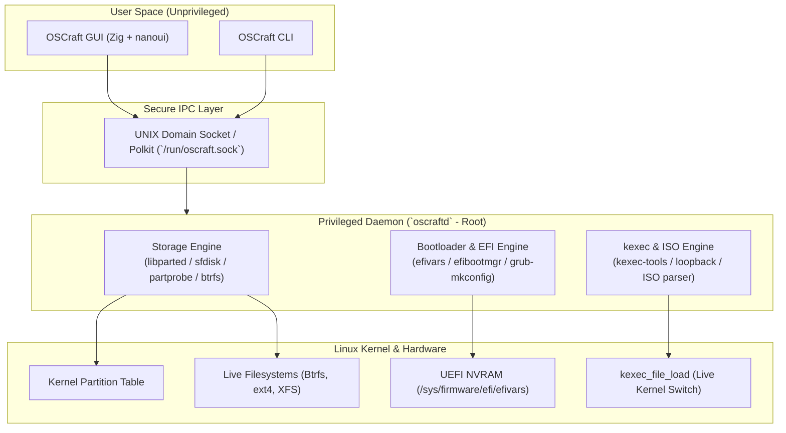

# OSCraft — Architecture & Engineering Blueprint

> **A high-performance, native Linux system utility for live partition management, zero-reboot OS switching via `kexec`, and USB-less live booting.**

* **Author:** [Oluwaferanmi Adeniji](https://github.com/Judeadeniji)
* **Date:** November 2026
* **License:** MIT

---

## 1. Executive Summary & Vision

Traditional Linux disk and OS management utilities (GParted, fdisk, Ventoy) often require full system reboots, external USB installation media, or complex command-line sequences when dealing with multi-boot environments, leftover OS partitions, corrupted bootloader entries, or orphaned EFI binaries.

**OSCraft** solves this by unifying three low-level Linux kernel capabilities into a modern, native application:

1. **Live Dynamic Storage Engine:** Safe partition deletion, sector gap discovery, partition creation, and live filesystem expansion (e.g. Btrfs pooling via `btrfs device add`, ext4/xfs live growth) without rebooting.
2. **UEFI & Bootloader Sanitizer:** Reading and modifying NVRAM boot entries (`efibootmgr`), cleaning ghost EFI directories on ESP (`/boot/efi/EFI/`), and synchronizing bootloader configurations.
3. **Zero-Reboot OS Switching (`kexec`) & USB-less ISO Booter:** Booting new OS environments and live ISOs directly from disk without external USB flash drives, and jumping straight into the new kernel in 2–3 seconds by bypassing hardware BIOS/POST.

---

## 2. High-Level Architecture

OSCraft adopts a **privilege-separated architecture** to ensure security and prevent GUI processes from running as root:



---

## 3. Core Engine Specifications

### 3.1. Pillar I: Live Storage & Partition Engine

* **Goal:** Modify, remove, and expand partitions on a live system with **zero downtime and no reboots**.
* **Capabilities:**
  * **Topological Disk Analysis:** Inspect raw block devices, physical sector boundaries, and calculate unallocated gaps down to the byte.
  * **1 MiB Sector Alignment:** Enforce strict sector alignment (multiples of 2048 for 512-byte logical sectors) to ensure optimal SSD/NVMe wear leveling and throughput.
  * **Process Blocker Detection:** Query `sysfs` and `/proc` to inspect open file handles and mount points (`fuser`/`lsof`) before unmounting.
  * **Live Kernel Table Reloading:** Dispatch `partprobe` or `partx -u` after partition table mutations to guarantee block device nodes match current disk state without rebooting.
  * **Btrfs Live Expansion:** Detect Btrfs multi-device capability. When adjacent partition expansion is geometrically blocked by sector layout, transparently allocate a new partition in unallocated space and run `btrfs device add` to expand `/` live.
  * **Standard Online Resizing:** Online expansion for ext4 (`resize2fs`) and XFS (`xfs_growfs`) when free space is contiguous to the right.

### 3.2. Pillar II: UEFI & Bootloader Sanitizer

* **Goal:** Eradicate ghost boot options and sync bootloader menus.
* **Capabilities:**
  * **NVRAM Entry Management:** Read `/sys/firmware/efi/efivars` to enumerate all `Boot####` entries, boot order, and active boot entries.
  * **ESP Orphan Scanner:** Cross-reference directories inside `/boot/efi/EFI/` against active NVRAM pointers. Detect abandoned distributions and offer 1-click cleanups.
  * **Automated Bootloader Regeneration:** Detect installed bootloader (GRUB 2, systemd-boot, Limine, rEFInd) and regenerate runtime configurations without manual terminal commands.

### 3.3. Pillar III: USB-Less ISO Booter & `kexec` Engine

* **Goal:** Boot an operating system or ISO directly from the internal drive without burning a physical USB thumb drive, and without hardware reboot delays.
* **Two Operating Modes:**
  1. **Mode A — Instant `kexec` Live Boot (Zero Hardware Reboot):**
     * User selects or downloads a Linux ISO.
     * OSCraft extracts the kernel (`vmlinuz`) and initial ramdisk (`initrd`/`initramfs`) from the ISO directly into memory.
     * Loads the kernel using `kexec -l <vmlinuz> --initrd=<initrd> --append="iso-scan/filename=/path/to.iso boot=live toram"`.
     * Prepares filesystem unmounts and issues `kexec -e` to jump the CPU directly to the new operating system in under 3 seconds.
  2. **Mode B — Persistent GRUB Loopback Entry:**
     * Places the ISO in a dedicated storage location (e.g., `/boot/iso/`).
     * Injects a clean `grub.d` loopback entry into the host GRUB configuration so the user can boot into that ISO anytime from their startup menu.

---

## 4. UI/UX Design (Powered by `nanoui`)

Using **`nanoui`** in Zig ensures:

* A tiny binary (~0.7 MB footprint) that can run even in ultra-lightweight rescue environments.
* Smooth, hardware-accelerated rendering (OpenGL on Linux) with zero CPU utilization when idle.

### Visual Wireframe Concept

```
┌────────────────────────────────────────────────────────────────────────┐
│ OSCraft                                                [ - ] [ □ ] [ ✕ ]│
├────────────────────────────────────────────────────────────────────────┤
│ Target Disk: /dev/nvme0n1 (1 TB NVMe SSD)                              │
│                                                                        │
│ [p1: EFI][p2: System] ─────── [ FREE: 450.0 GiB ] ─────── [p3: Root /] │
│   512 MB   64 GB                 Unallocated                  500 GB   │
│                                                                        │
│ Diagnostics & Actions:                                                 │
│  [✦ 1-Click Fix]  Clean 1 orphaned UEFI boot entry found               │
│  [⇥ Expand Pool]   Merge unallocated space into / (Btrfs)              │
│  [⚡ Quick Boot]   Boot an ISO directly without reboot (kexec)         │
│  [+ Install ISO]  Register ISO to GRUB menu (No USB needed)            │
├────────────────────────────────────────────────────────────────────────┤
│ Activity Log:                                                          │
│  ✓ /dev/nvme0n1 scanned: 3 partitions, 1 unallocated gap found         │
│  ✓ Root filesystem healthy, 210 GiB available                          │
└────────────────────────────────────────────────────────────────────────┘
```

---

## 5. Security & Safety Model

1. **Transaction Dry-Run Mode:**
   * Every disk change (partition deletion, resizing, device addition) generates a detailed JSON execution plan before any destructive action takes place.
2. **GPT Header Backup:**
   * Before modifying any partition table, a binary backup of the Primary and Secondary GPT headers is written to `/var/lib/oscraft/backups/`.
3. **Protected Partition Guardrails:**
   * Active root `/`, `/boot`, `/boot/efi`, and swap partitions are locked against accidental deletion. A multi-step confirmation and typed token check are enforced for sensitive operations.
4. **Non-Root UI:**
   * The UI runs under the user's unprivileged session. It communicates with `oscraftd` or requests elevation via Polkit (`pkexec`) only when executing approved transactions.

---

## 6. Implementation Roadmap

### Phase 1: Storage Scanner & Live Partition Engine

- [x] Build disk topology and unallocated gap detector in Zig (`src/storage/disk.zig`).
* [x] Implement sector alignment calculator (1 MiB alignment).
* [x] Build behavioral and topological test suite (`src/storage/disk_test.zig`).
* [ ] Implement live Btrfs pooling (`btrfs device add` integration).
* [ ] Implement automated `partprobe` live kernel table reload.

### Phase 2: UEFI & Bootloader Sanitation

- [ ] Implement `/sys/firmware/efi/efivars` reader and entry parser.
* [ ] Build orphan EFI directory scanner (`/boot/efi/EFI/*`).
* [ ] Implement safe entry removal and automated bootloader synchronization (`update-grub`).

### Phase 3: USB-Less ISO & `kexec` Engine

- [ ] Implement ISO inspection tool (parse ISO headers to find `/casper/vmlinuz`, `/arch/boot/`, etc.).
* [ ] Add GRUB loopback injection script generator.
* [ ] Add `kexec` staging and execution engine for instant live boot.

### Phase 4: `nanoui` Native Frontend

- [ ] Design the interactive visual partition bar component.
* [ ] Build the Action Confirmation modal with dry-run diff preview.
* [ ] Integrate off-screen snapshot tests (`nui snapshot`) for automated visual regression testing.
